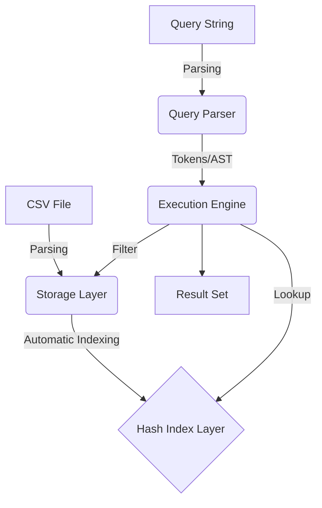

# CSV Mini Database & Query Engine

實作一個輕量級的 CSV 小型資料庫與查詢引擎，涵蓋從基礎解析、高效索引技術到複合查詢語法開發的完整流程。本專案專為高效數據檢索設計，適合學習資料庫系統核心邏輯與 C++ 高效能編程。

## 🚀 核心功能

- **高效 CSV 解析**: 整合 `vcpkg` 管理的 **`csv-parser`** 函式庫，支援記憶體映射 (Memory-mapped I/O)，大幅提升大檔案讀取效能。
- **In-Memory Hash Index**: 資料載入時自動為所有欄位建立雜湊索引 (Hash Index)，實現 $O(1)$ 的精確匹配查詢。
- **強大查詢引擎**: 支援類 SQL 語法，具備單一與複合條件 (`AND`, `OR`) 解析能力，並能處理複雜的謂詞過濾。
- **類型推斷系統**: 自動識別 CSV 欄位型別（如整數、浮點數、字串），優化儲存與比較邏輯。

## 🏗️ 架構設計

本系統採用分層架構，確保各模組間的低耦合性與高效協作：



1. **Storage Layer**: 將資料載入至記憶體中，並為每一列分配唯一的 `RowID`。
2. **Index Layer**: 建立欄位值與 `RowID` 列表的映射關係：`Value -> std::vector<RowID>`。
3. **Execution Engine**: 結合索引查詢與集合運算（交集與聯集），快速得出篩選結果。

## 🔍 查詢語法規範

支援標準的 `SELECT ... WHERE ...` 格式：

### 查詢範例
- **基本查詢**: `SELECT * FROM students WHERE ID = '123'`
- **複合查詢**: `SELECT Name, Age FROM students WHERE Grade = 'A' AND Age < '20'`
- **多重條件**: `SELECT * FROM students WHERE City = 'Taipei' OR City = 'Hsinchu'`

> [!TIP]
> 系統會優先利用 Hash Index 縮小搜尋範圍，複合條件下會進行集合運算 (Intersection/Union) 以保證極致的查詢速度。

## 🛠️ 建置與執行

### 環境需求
- **C++ 標準**: C++17 或以上
- **包管理器**: [vcpkg](https://github.com/microsoft/vcpkg)
- **建置工具**: CMake 3.10+

### 本機建置
1. **安裝依賴**:
   ```bash
   vcpkg install csv-parser gtest
   ```
2. **編譯專案**:
   ```bash
   mkdir build && cd build
   cmake .. -DCMAKE_TOOLCHAIN_FILE=[path/to/vcpkg]/scripts/buildsystems/vcpkg.cmake
   make
   ```
3. **執行主程式**:
   ```bash
   ./csv_mini_db ../sample_data.csv "SELECT * FROM data WHERE Grade = 'A'"
   ```
4. **執行測試**:
   ```bash
   ctest
   # or
   ./csv_db_tests
   ```

### Docker 建置
本專案支援 Docker 容器化開發環境。Dockerfile 會自動設定 `vcpkg` 並編譯所有相依套件，確保開發者在任何平台都能擁有一致的執行環境。
```bash
docker build -t csv-db-engine .
docker run -it csv-db-engine
```

## 🧪 測試策略
- **單元測試**: 使用 Google Test 驗證解析器與索引邏輯。
- **壓力測試**: 針對數十萬列的 CSV 進行查詢延遲測試。
- **CI/CD 構想**: 透過自動化流程在每次提交時執行單元測試與 Linter 校驗，確保代碼品質。

## 📁 專案結構

```
.
├── CMakeLists.txt              # 主 CMake 配置
├── vcpkg.json                  # vcpkg 依賴管理
├── src/
│   ├── main.cpp               # CLI 入口點
│   ├── csv_parser.cpp         # CSV 解析實現
│   ├── storage.cpp            # 儲存層實現
│   ├── hash_index.cpp         # 雜湊索引實現
│   ├── query_parser.cpp       # 查詢解析實現
│   └── execution_engine.cpp   # 執行引擎實現
├── include/
│   ├── types.h                # 核心類型定義 (RowID, Row, AST, etc.)
│   ├── utils.h                # 工具函數 (字符串, 類型推斷, 集合運算)
│   ├── csv_parser.h           # CSV 解析介面
│   ├── storage.h              # 儲存層介面
│   ├── hash_index.h           # 雜湊索引介面
│   ├── query_parser.h         # 查詢解析介面
│   └── execution_engine.h     # 執行引擎介面
├── test/
│   ├── CMakeLists.txt         # 測試 CMake 配置
│   ├── test_csv_parser.cpp    # CSV 解析測試 (UT-01)
│   ├── test_storage.cpp       # 儲存層測試 (UT-02)
│   ├── test_hash_index.cpp    # 雜湊索引測試 (UT-03)
│   ├── test_query_parser.cpp  # 查詢解析測試 (UT-04)
│   ├── test_execution_engine.cpp # 執行引擎測試 (UT-06)
│   └── test_type_inference.cpp   # 類型推斷測試 (UT-05)
├── docs/                      # 文檔目錄
│   ├── 00_intended_use.md     # 需求定義
│   ├── 01_plan.md             # 專案計劃
│   ├── 02_SRS.md              # 軟體需求規格
│   ├── 03_SDS.md              # 軟體設計規格
│   ├── 04_test_plan.md        # 測試計劃
│   └── ...
├── sample_data.csv            # 範例 CSV 檔案
└── README.md                  # 本檔案
```

## 🚀 快速開始

### 基本用法

```bash
# 查詢所有 Grade = 'A' 的學生
./csv_mini_db sample_data.csv "SELECT * FROM data WHERE Grade = 'A'"

# 查詢特定欄位
./csv_mini_db sample_data.csv "SELECT Name, Age FROM data WHERE Age > 19"

# 複合條件查詢
./csv_mini_db sample_data.csv "SELECT * FROM data WHERE Grade = 'A' AND Age < 21"
```

### 概念說明

#### 1. CSV 解析 (CSV Parser)
- 讀取 CSV 檔案，處理逗號分隔與引號欄位
- 將首行視為列標題，後續列為數據

#### 2. 儲存層 (Storage Layer)
- 將解析的每一列分配唯一的 RowID (0, 1, 2, ...)
- 數據存儲於 `std::vector<Row>`，支持 O(1) 按 RowID 存取

#### 3. 雜湊索引 (Hash Index)
- 為每個欄位建立 `Value -> std::vector<RowID>` 映射
- 支持精確值查詢 O(1) 時間複雜度
- 非等值查詢 (<, >, <=, >=, !=) 透過掃描結合比較實現

#### 4. 查詢解析 (Query Parser)
- 遞迴下降解析器 (Recursive Descent Parser)
- 支援 SELECT 和 WHERE 子句
- 生成抽象語法樹 (AST) 表示複合條件

#### 5. 執行引擎 (Execution Engine)
- 評估 AST，透過索引查詢符合條件的 RowID
- 使用集合運算 (intersection/union) 整合 AND/OR 結果
- 提取並返回指定欄位的結果集

## 🎯 效能指標

根據 SRS-P001 至 SRS-P003：

| 指標 | 目標 | 說明 |
|------|------|------|
| 精確匹配查詢 | O(1) | 透過 Hash Index 實現 |
| 100K 行查詢 | < 100ms | 非等值條件掃描 + 集合運算 |
| 1M 行支援 | ✓ | 受制於可用記憶體 |

## 📖 文檔參考

詳細的需求與設計資訊請參閱 `docs/` 目錄：

- [SRS (Software Requirements Specification)](docs/02_SRS.md) - 功能需求、效能目標、約束
- [SDS (Software Design Specification)](docs/03_SDS.md) - 架構、模組設計、數據結構
- [Test Plan](docs/04_test_plan.md) - 單元測試、壓力測試、集成測試 (IT-01)

## 🤝 貢獻指南

1. 建立特徵分支 (`git checkout -b feature/short-feature-name`)
2. 實施變更並編寫測試
3. 確保所有測試通過 (`ctest`)
4. 發送 Pull Request

## 📝 授權

本專案為教學用途，遵循 MIT License。