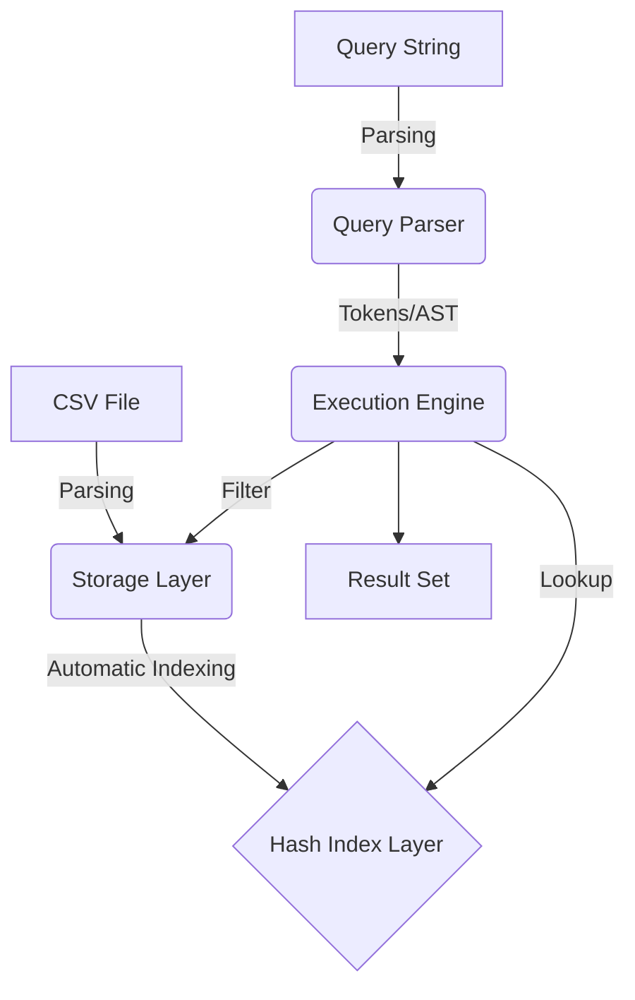

# CSV Mini Database & Query Engine

實作一個輕量級的 CSV 小型資料庫與查詢引擎，涵蓋從基礎解析、高效索引技術到複合查詢語法開發的完整流程。本專案專為高效數據檢索設計，適合學習資料庫系統核心邏輯與 C++ 高效能編程。

## 🚀 核心功能

- **高效 CSV 解析**: 整合 `vcpkg` 管理的 **`csv-parser`** 函式庫，支援記憶體映射 (Memory-mapped I/O)，大幅提升大檔案讀取效能。
- **In-Memory Hash Index**: 資料載入時自動為所有欄位建立雜湊索引 (Hash Index)，實現 $O(1)$ 的精確匹配查詢。
- **強大查詢引擎**: 支援類 SQL 語法，具備單一與複合條件 (`AND`, `OR`) 解析能力，並能處理複雜的謂詞過濾。
- **類型推斷系統**: 自動識別 CSV 欄位型別（如整數、浮點數、字串），優化儲存與比較邏輯。

## 🏗️ 架構設計

本系統採用分層架構，確保各模組間的低耦合性與高效協作：



1. **Storage Layer**: 將資料載入至記憶體中，並為每一列分配唯一的 `RowID`。
2. **Index Layer**: 建立欄位值與 `RowID` 列表的映射關係：`Value -> std::vector<RowID>`。
3. **Execution Engine**: 結合索引查詢與集合運算（交集與聯集），快速得出篩選結果。

## 🔍 查詢語法規範

支援標準的 `SELECT ... WHERE ...` 格式：

### 查詢範例
- **基本查詢**: `SELECT * FROM students WHERE ID = '123'`
- **複合查詢**: `SELECT Name, Age WHERE Grade = 'A' AND Age < '20'`
- **多重條件**: `SELECT * WHERE City = 'Taipei' OR City = 'Hsinchu'`

> [!TIP]
> 系統會優先利用 Hash Index 縮小搜尋範圍，複合條件下會進行集合運算 (Intersection/Union) 以保證極致的查詢速度。

## 🛠️ 建置與執行

### 環境需求
- **C++ 標準**: C++17 或以上
- **包管理器**: [vcpkg](https://github.com/microsoft/vcpkg)
- **建置工具**: CMake 3.10+

### 本機建置
1. **安裝依賴**:
   ```bash
   vcpkg install csv-parser gtest
   ```
2. **編譯專案**:
   ```bash
   mkdir build && cd build
   cmake .. -DCMAKE_TOOLCHAIN_FILE=[path/to/vcpkg]/scripts/buildsystems/vcpkg.cmake
   make
   ```

### Docker 建置
本專案支援 Docker 容器化開發環境。Dockerfile 會自動設定 `vcpkg` 並編譯所有相依套件，確保開發者在任何平台都能擁有一致的執行環境。
```bash
docker build -t csv-db-engine .
docker run -it csv-db-engine
```

## 🧪 測試策略
- **單元測試**: 使用 Google Test 驗證解析器與索引邏輯。
- **壓力測試**: 針對數十萬列的 CSV 進行查詢延遲測試。
- **CI/CD 構想**: 透過自動化流程在每次提交時執行單元測試與 Linter 校驗，確保代碼品質。